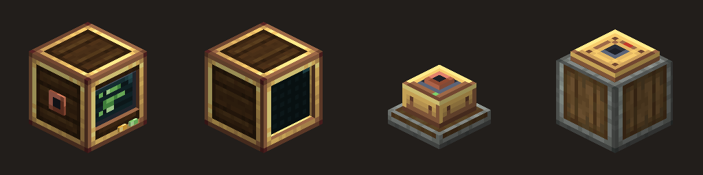
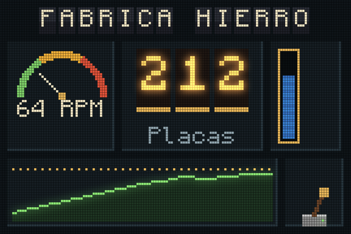
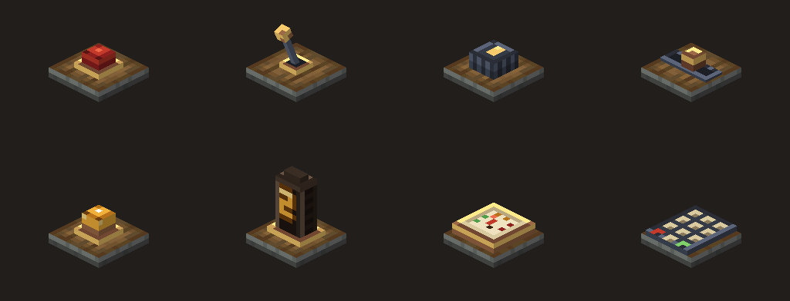

# Create: New Era

**Programmable automation for [Create](https://github.com/Creators-of-Create/create).** Brass computers that run Lua, a data bus that reaches every machine, buildable control panels, and a mechanical flip-pixel screen. Built for factories, fluids, trains and [Create: Aeronautics](https://modrinth.com/mod/create-aeronautics) ships alike.

> **Status: early development (phase 2).** The Brass Computer runs Lua and drives redstone, with an in-game editor. Screens join into big panes but can't draw yet. The data bus, drawing on screens and the panel controls come next.

<p align="center">
  
</p>

## The idea

CC: Tweaked lets you program Minecraft. Create: New Era is meant to feel like part of Create itself:

- **Brass Computer.** Runs Lua programs that read and drive every machine wired to it.
- **Universal Adapter.** Stick it on any Create block (kinetics, inventories, tanks, trains) and that block shows up on the data bus.
- **Bearing Servo.** Turns a contraption to an exact angle on command, for gimbals, turrets, flaps and stabilisers on Aeronautics ships.
- **Panel controls.** Small blocks you place on any face to build real control desks: buttons, switches, knobs, sliders, lamps, nixie digits, gauges and keypads.
- **Brass Screen.** Joins into large displays made of physical flip pixels, 48 per block, that rotate when they change. You can pick square plates or round discs in the client config.

<p align="center">
  
  <br><sub>Prototype of a 3×2 screen at 48 px per block (rendered outside the game)</sub>
</p>

<p align="center">
  
</p>

## What works today

### Brass Computer

Right-click it to open the editor, write some Lua, press **Run**. Every new computer comes with a program that blinks a redstone signal out of its top (put a lamp on it):

```lua
while true do
  redstone.setOutput("top", true)
  sleep(0.5)
  redstone.setOutput("top", false)
  sleep(0.5)
end
```

| API | What it does |
| --- | --- |
| `print(...)` | Writes a line to the console under the editor |
| `sleep(seconds)`, `os.sleep` | Waits in game time (20 ticks a second) |
| `os.clock()` | Seconds since the program started |
| `os.speed()` | RPM the computer turns at (negative when it turns the other way) |
| `require(name)` | Runs another file on the computer once and returns what it returned (`require("lib.pid")` finds `lib/pid.lua`) |
| `redstone.getInput(side)`, `getAnalogInput(side)` | Signal coming in, as on/off or 0–15 |
| `redstone.setOutput(side, on)`, `setAnalogOutput(side, 0–15)` | Signal going out |
| `redstone.getOutput(side)`, `getAnalogOutput(side)`, `getSides()` | What we're sending, and the side names |

Sides are named from the computer's front: `front`, `back`, `left`, `right`, `top`, `bottom` (left and right as you see them facing it). `rs` is short for `redstone`. The usual `string`, `table`, `math`, `coroutine`, `utf8` and `bit32` libraries are there.

The editor works like a small VS Code: files open in tabs, the side panel switches between **Files**, **Redstone** (live signal on every side) and **Flows** (coming with the data bus), suggestions pop up as you type, and the window, the console and the side panel can all be dragged to any size. Clicking an error in the console jumps to its line.

**Editor shortcuts:**

| Key | Does |
| --- | --- |
| Ctrl+R / Ctrl+T | Run the open file / stop |
| Ctrl+Space | Suggestions (Tab or Enter to accept) |
| Ctrl+N, Ctrl+W, Ctrl+Tab | New file, close tab, next tab |
| Ctrl+B | Show or hide the side panel |
| Ctrl+S | Save (it also autosaves while you type) |
| Ctrl+Z / Ctrl+Y | Undo / redo |
| Ctrl+D, Ctrl+/ | Duplicate line, comment lines in or out |
| Tab / Shift+Tab | Indent / unindent |
| Esc | Save and close |

**Computers run on rotational force.** Put a shaft into the back: the faster it spins, the bigger the slice of each tick the program gets (up to 2 ms at 256 RPM, half that at 128). It costs 2 SU per RPM, like any Create machine. Without rotation, or when the network is overstressed, the program pauses exactly where it is and carries on when the shaft turns again. A program that loops without sleeping is paused at the end of its slice and picked up next tick, so it slows itself down instead of the server. A program that was running when the world was saved starts again when it loads.

### Blocks and recipes

Everything sits in its own **Create: New Era** creative tab, right after Create's tabs.

| Block | Recipe |
| --- | --- |
| Brass Computer | Mechanical Crafting: brass casing, electron tubes, precision mechanism, brass sheets, glass panes |
| Brass Screen ×2 | Crafting: brass casing, 2 electron tubes, 3 glass panes |
| Universal Adapter | Item Application: electron tube onto andesite casing |
| Bearing Servo | Item Application: precision mechanism onto mechanical bearing |
| Control Plate ×4 | 2 andesite alloy + brass sheet |
| Panel controls | Control plate + one part (red button, lever, hand crank, brass sheet, glowstone, nixie tube, speedometer, buttons) |

Every block can be rotated with Create's wrench, has collision shapes fitted to its model and is mined with a pickaxe. Each one has Create-style tooltips (hold Shift for details, Ctrl for controls) and a Ponder scene (hold W). Brass Screens placed side by side, facing the same way, join into one pane. English and Spanish are included.

## Roadmap

1. ~~**Foundation.** Blocks, recipes, creative tab, Create and Aeronautics dependencies~~
2. **Lua runtime.** ~~Sandboxed VM, in-game editor, redstone API~~; files and multiple programs still to come
3. **Data bus.** Cables and adapters that expose Create machines as typed peripherals
4. **Flip-pixel screens.** Multiblock screens and a declarative UI library for good-looking dashboards
5. **Panels.** Wire the controls to programs
6. **Aeronautics.** Servos, sensors, then autonomous and remote-piloted drones with signal towers
7. **Visual programming.** Node-based programming for people who'd rather not write Lua

## Requirements

| | Version |
| --- | --- |
| Minecraft | 1.21.1 |
| NeoForge | 21.1.265 or newer |
| Create | 6.0.10 or newer |
| Create: Aeronautics | 1.3 or newer (optional) |

## Building from source

```sh
./gradlew build            # jar ends up in build/libs/
./gradlew runClient        # play with the mod
./gradlew runGameTestServer  # in-game tests: blocks, recipes, screens joining, Lua programs, Ponder structures
./gradlew runData          # regenerate blockstates, item models, loot tables, tags, en_us
```

You only need a JDK 17 or newer to start Gradle; it downloads JDK 21 on its own.

### Live reloading

`runClient` starts on the JetBrains Runtime with a debug port, so most code changes don't need a restart:

```sh
./gradlew hotswap   # recompile and swap the changed classes into the running game
```

Textures, models and lang are copied too: press F3+T in game. Recipes and other data: `/reload`. New blocks, items or network payloads still need a restart. Turn it off with `dev_hotswap=false`.

### Dev environment

`runClient` downloads a realistic modpack into `run/` the first time (checksum-verified, see [`gradle/dev-mods.gradle`](gradle/dev-mods.gradle)), so we test against what players actually run:

- Sodium, Lithium, ModernFix, FerriteCore, ImmediatelyFast, Entity Culling
- Iris with Complementary Reimagined (enabled on first launch) and Unbound
- Create: Aeronautics and Sable

The server and GameTest runs use `run/server/` and only get Aeronautics and Sable. You can switch each group off in `gradle.properties` (`dev_client_mods`, `dev_shaders`, `dev_aeronautics`).

### Asset tools

Block textures and models are generated by script so they stay consistent with Create's palette:

| Script | What it does |
| --- | --- |
| [`tools/textures/gen_textures.py`](tools/textures/gen_textures.py) | Detail atlases, with palettes sampled from Create's casings |
| [`tools/models/gen_models.py`](tools/models/gen_models.py) | Block models |
| [`tools/render/iso_render.py`](tools/render/iso_render.py) | Renders block models to PNG without launching the game (made the images above) |
| [`tools/screen/proto_screen.py`](tools/screen/proto_screen.py) | Prototype of the flip-pixel screen look |
| [`tools/ponder/gen_ponder.py`](tools/ponder/gen_ponder.py) | Structures the Ponder scenes play out on |

## Credits

Create: New Era is an unofficial add-on. It isn't affiliated with the Create team.

- [Create](https://github.com/Creators-of-Create/create) by simibubi and the Creators of Create
- [Create: Aeronautics](https://modrinth.com/mod/create-aeronautics) and [Sable](https://github.com/ryanhcode/sable)
- [Cobalt](https://github.com/cc-tweaked/Cobalt), the Lua VM from CC: Tweaked (MIT), bundled in the jar
- The screen prototype uses [Monocraft](https://github.com/IdreesInc/Monocraft) (SIL Open Font License)

## License

Public domain under [The Unlicense](LICENSE): copy it, fork it, ship it in a modpack, sell it, whatever you like. No permission or credit needed.
